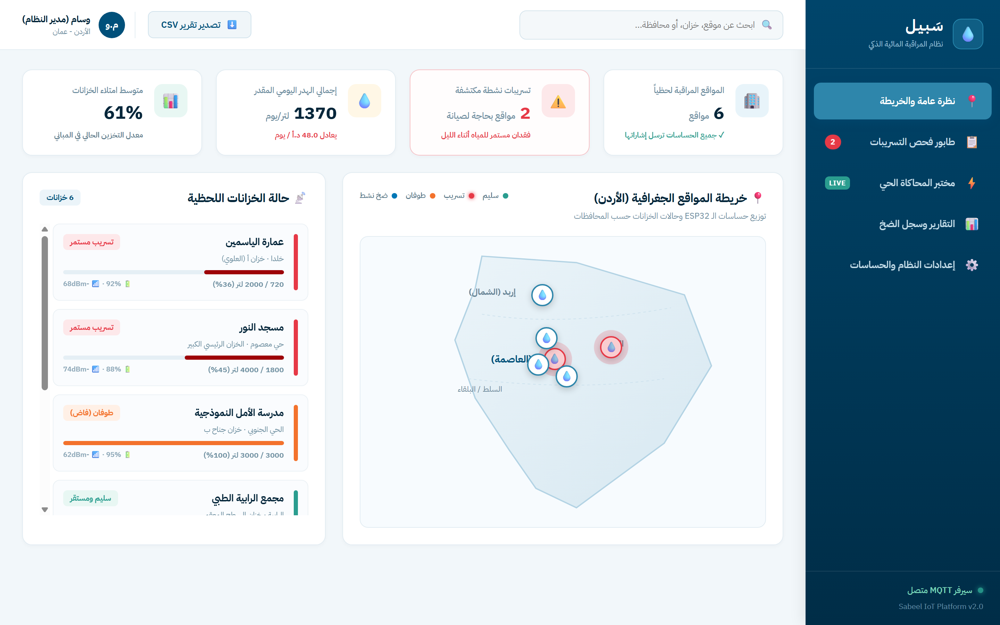
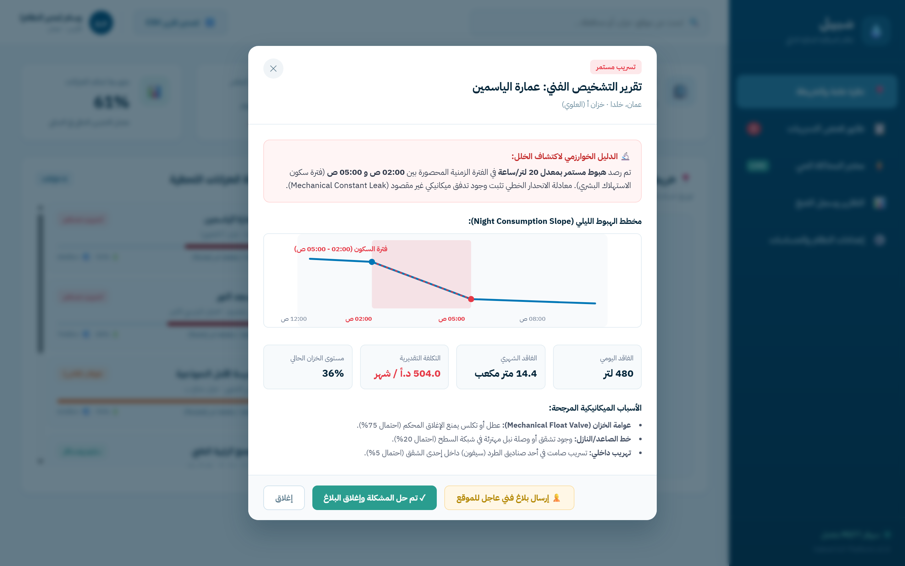
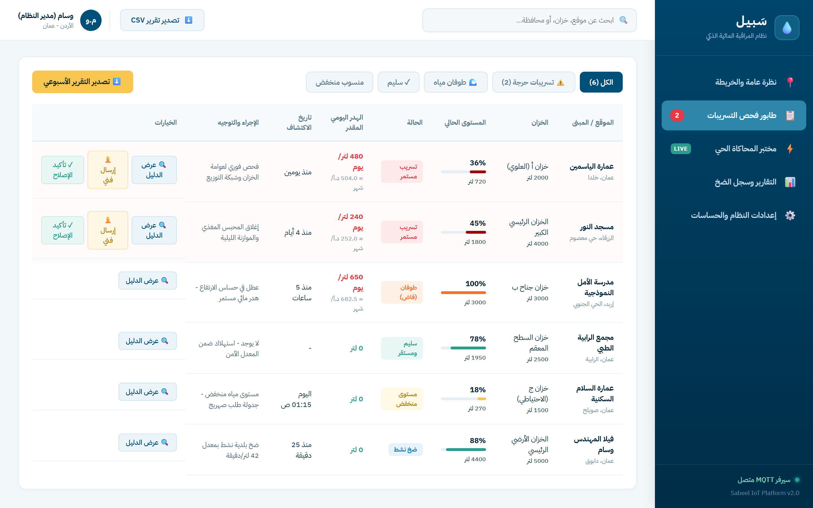
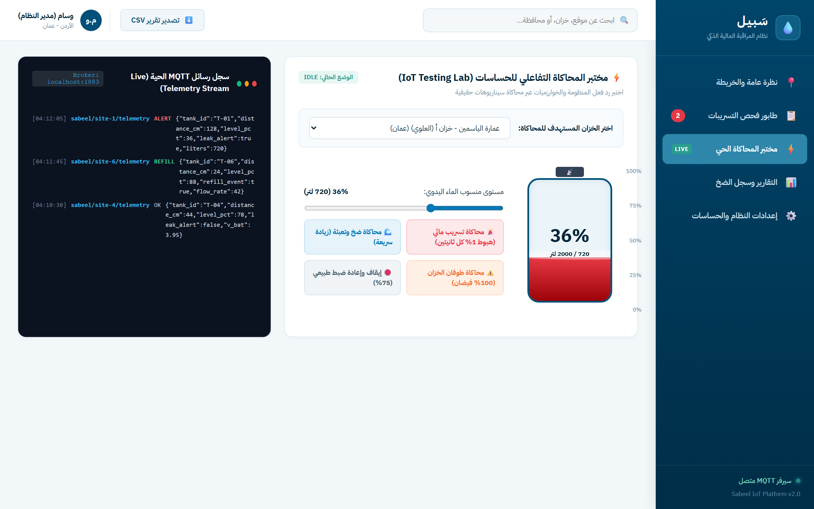
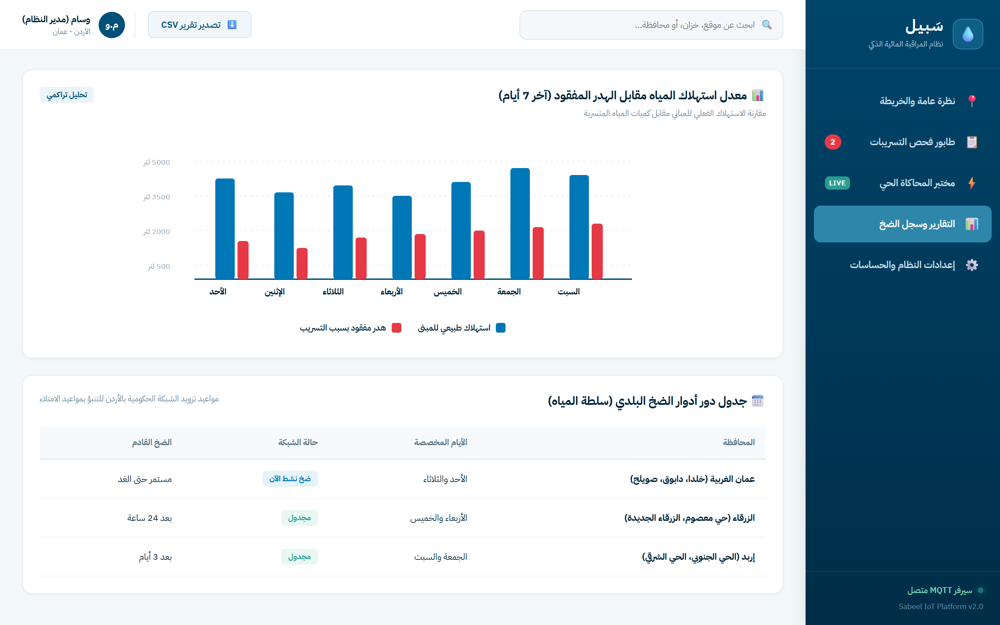
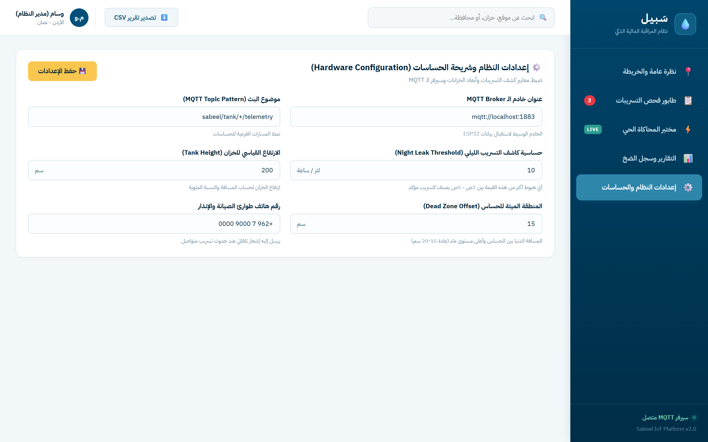
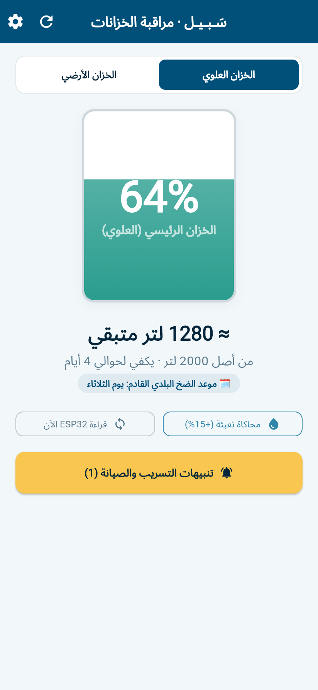
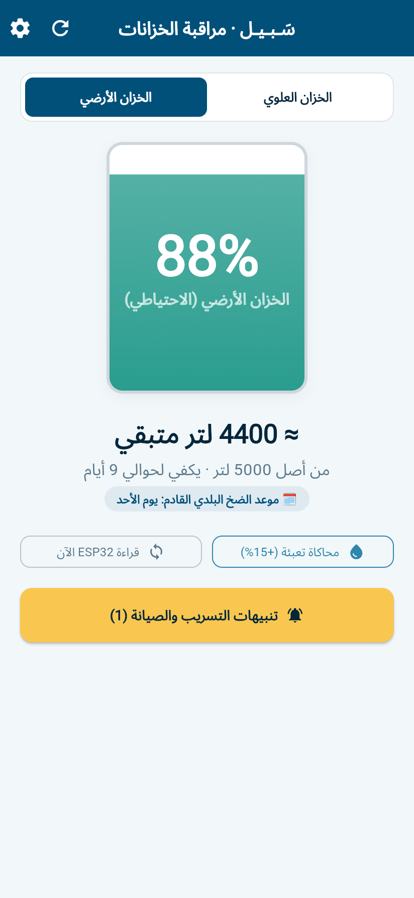
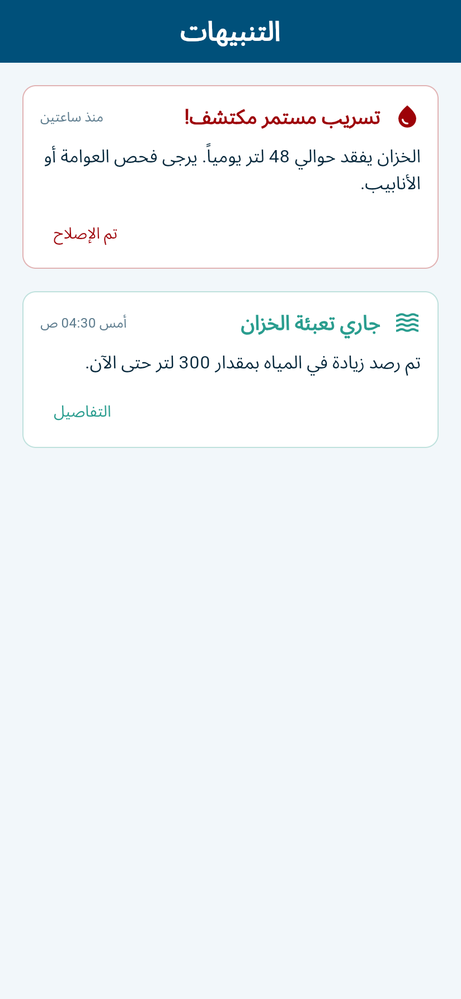
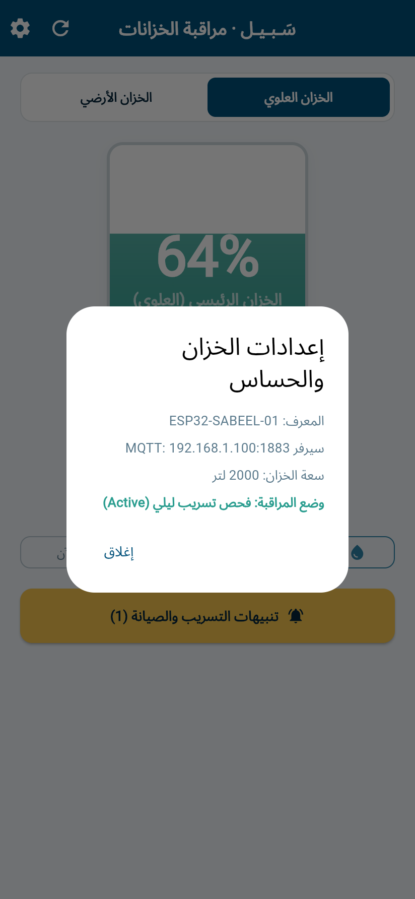

# سبيل · Sabeel 💧
### Smart Water Intelligence & Acoustic Leak Detection Platform for Intermittent Supply Networks

> **"Know how much water you have. Know the moment you start losing it."**  
> An end-to-end IoT and analytics platform engineered specifically for the **intermittent municipal water supply & rooftop tank architecture** dominant across Jordan and the Middle East.

---

[](https://dotnet.microsoft.com/)
[](https://angular.dev/)
[](https://flutter.dev/)
[](https://www.espressif.com/)
[](https://mqtt.org/)
[](https://www.timescale.com/)
[](https://www.docker.com/)

---

## 📸 معرض الواجهات والأنظمة المكتملة (Visual Showcase)

### أولاً: لوحة التحكم الميدانية للبلديات وإدارة المباني (Angular Fleet Dashboard)

#### 1. الخريطة التفاعلية للمحافظات الأردنية والنظرة العامة (GIS Fleet Map & KPIs)
> *تتبع جغرافي لحظي لمواقع الخزانات وحساسات ESP32 عبر المحافظات (عمان، الزرقاء، إربد، السلط)، مع رصد فوري لحالات التسريب، الطوفان، ومتوسط الامتلاء.*



---

#### 2. تقرير التشخيص العلمي وتحليل الانحدار الليلي (Algorithmic Leak Diagnostics Modal)
> *نافذة الفحص الفني المتقدم: تثبت التسريب الميكانيكي بدليل رياضي ناتج عن هبوط المنسوب في فترة سكون الاستهلاك البشري (02:00 ص - 05:00 ص)، مع تقدير الفاقد المالي والأسباب المرجحة وتوجيه بلاغ فني.*



---

#### 3. طابور فحص وتصنيف التسريبات الميدانية (Leak Detection Triage Queue)
> *جدول العمل الميداني مرتب تلقائياً حسب معدل الفاقد اليومي (لتر/يوم)، مع أزرار الإجراءات الفورية، تأكيد الإصلاح، وتصدير التقارير الفنية المعتمدة.*



---

#### 4. مختبر المحاكاة الحي وبث رسائل MQTT (IoT Interactive Simulation Lab)
> *بيئة محاكاة واختبار متكاملة تسمح باختبار رد فعل المنظومة والخوارزميات عبر سيناريوهات حية (تسريب مستمر، طوفان، ضخ وتعبئة) مع سجل مباشر لحزم MQTT الواردة من الحساسات.*



---

#### 5. التحليلات وسجل أدوار الضخ البلدي (Water Balance & Municipal Supply Schedule)
> *مقارنة استهلاك المياه الطبيعي مقابل الهدر المفقود خلال آخر 7 أيام، متكاملاً مع جدول أدوار ضخ سلطة المياه حسب المحافظات والمناطق.*



---

#### 6. إعدادات النظام ومعايرة الحساسات (Hardware Configuration & Calibration)
> *ضبط معايير كشف التسريب الليلي، نمط مواضيع الـ MQTT، أبعاد الخزانات، والمسافة الميتة (Dead Zone) لحساس الموجات فوق الصوتية.*



---

### ثانياً: تطبيق الهاتف الذكي للمستهلك المنزلي (Flutter Household Mobile App)

| الخزان الرئيسي العلوي (Rooftop Tank) | الخزان الأرضي الاحتياطي (Ground Tank) |
|:---:|:---:|
| محاكاة بصرية لمستوى الماء مع عداد الأيام وموعد الضخ | مراقبة الخزان الأرضي وتدفق مياه البلدية |
|  |  |

| تنبيهات التسريب والصيانة (Leak Alerts) | تشخيص حساس الـ ESP32 (Diagnostics) |
|:---:|:---:|
| رصد فوري للتسريب المستمر وتوجيه المستخدم للإصلاح | معلومات الاتصال بسيرفر MQTT وحالة المراقبة |
|  |  |

---

## 🎯 المشكلة والحل الواقعي (The Problem & Solution)

في الأردن والعديد من دول المنطقة، تُضخ المياه إلى الأحياء السكنية **بشكل دوري ومتقطع** (مرة واحدة أسبوعياً)، مما يفرض وجود خزانات فوق أسطح المنازل. هذه الطبيعة تخلق تحديات جسيمة:
1. **الجهل بالكمية المتبقية:** الاعتماد على طرق بدائية (طرق الخزان يدوياً).
2. **فوات نافذة الضخ:** عدم الاستفادة من مياه الشبكة إذا كان المحبس مغلقاً أو العوامة معطلة.
3. **التسريبات الصامتة (Silent Leaks):** تسريب خفي في شبكة المنزل أو صندوق الطرد يؤدي إلى تفريغ الخزان بالكامل قبل موعد الضخ القادم.
4. **طوفان الخزانات وتلف المضخات:** هدر هائل للمياه عند تعطل العوامة، أو احتراق المضخات عند عملها على الجاف (Dry-Run).

### خوارزمية كشف التسريب الليلي (The Core Night-Flow Algorithm)
بما أن الخزان لا يرتفع إلا أثناء الضخ، فإن **مشتقة منحنى الحجم بالنسبة للزمن تمثل إشارة الاستهلاك مباشرة**.  
بين الساعة 01:00 والساعة 05:00 فجراً، يجب أن يصل الاستهلاك البشري الطبيعي إلى **صفر**.  
إذا استمر انحدار مستوى الماء ليلاً بشكل متواصل لعدة أيام:
$$\text{nightSlope} = \text{median}\left(\frac{\Delta \text{volume}}{\Delta t}\right)_{01:00-05:00}$$
$$\text{if } \text{nightSlope} < -\text{MIN\_LEAK\_RATE} \implies \textbf{CONTINUOUS\_LEAK}$$

---

## 🏗️ البنية التقنية للمشروع (Architecture)

```
sabeel/
├── apps/
│   ├── dashboard/          # Angular 18 Enterprise Fleet Dashboard (Signals, SVG Map, Arabic RTL)
│   └── mobile/             # Flutter Mobile App for Households (Animated Tank, Alerts, Arabic RTL)
├── server/
│   └── src/
│       ├── Sabeel.Ingest/  # High-throughput MQTT to TimescaleDB ingestion worker
│       ├── Sabeel.Analytics/# Night-flow detector, refill classifier, schedule learner
│       └── Sabeel.Domain/  # Site, Tank, Device, Reading domain contracts
├── firmware/
│   └── src/                # ESP32 C++ firmware (JSN-SR04T ultrasonic, median filter, deep sleep, MQTT)
├── simulator/              # Node.js synthetic IoT tank trace & leak publisher
├── database/
│   └── schema.sql          # TimescaleDB hypertables, continuous aggregates, retention policies
├── docs/
│   ├── hardware.md         # BOM (< 25 JOD), schematic, assembly
│   └── screenshots/        # High-resolution visual showcase
└── docker-compose.yml      # Orchestrates Mosquitto, Ingestion, API, DB & Simulator
```

---

## 🚀 تشغيل المنظومة محلياً (Quickstart)

### 1. تشغيل لوحة التحكم (Angular Web Dashboard)
```bash
cd apps/dashboard
npm install
npm start
# Visit: http://localhost:4200
```
*أو عبر النقر المزدوج على ملف: `RUN_DASHBOARD.bat`*

### 2. تشغيل تطبيق الهاتف (Flutter App)
```bash
cd apps/mobile
flutter pub get
flutter run -d chrome --web-port=5000
# Visit: http://localhost:5000
```
*أو عبر النقر المزدوج على ملف: `RUN_MOBILE.bat`*

---

## 👨‍💻 إشراف وهندسة
**وسام (Wesam)** — هندسة الحوسبة والأجهزة الذكية (Smart Devices Computing)  
*مشروع متكامل يربط بين الأنظمة المدمجة (IoT Hardware)، البروتوكولات الشبكية (MQTT)، وتحليل البيانات الضخمة (Time-Series Analytics) والواجهات الذكية.*
